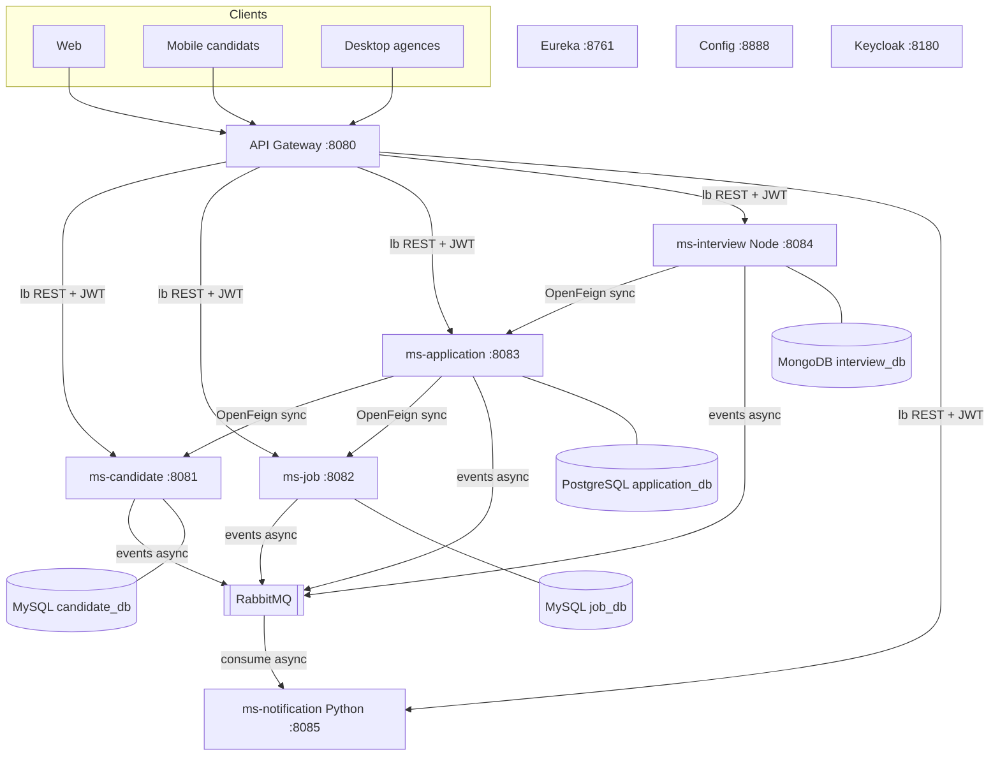

# Prosit n°2 — JobBoard : du backend monolithique aux microservices

> **TalentConnect / JobBoard** · ESPRIT · AWD · 2026-2027  
> Sources vérifiées : `BackEndRestFul_SpringBoot/awd-monolith` (Spring Boot **3.5.6**, MySQL `awd_db`, port **8080**).  
> Livrable = **dossier de conception** + journal d’équipe + slides. **Pas d’implémentation** requise pour ce prosit.  
> Équipe : Mohamed Aziz Mehrez, Mohamed Rayen Sboui, Maryem Slatni, Mohamed Ezzedine Zouiten, Dhia Jbali.

---

## 1. Définitions (mots-clés) — appliquées à JobBoard

| Terme | Définition (nos mots) · lien JobBoard |
|---|---|
| **Backend monolithique** | Une seule application déployable qui concentre toutes les capacités (candidat, offre, candidature) dans **un** process JVM. Chez TalentConnect : artifact Maven `awd-monolith`, un `@SpringBootApplication`, un port `8080`. |
| **API REST / contrat OpenAPI** | Interface HTTP ressource/verbe (GET/POST/…) dont le contrat machine-lisible est OpenAPI/Swagger. Preuve monolithe : springdoc (`/v3/api-docs`, `/swagger-ui.html`) expose `/api/candidates`, `/api/jobs`, `/api/applications`. |
| **Couplage et cohésion** | **Cohésion** = éléments d’un module liés par la même raison de changer. **Couplage** = dépendance entre modules. Le monolithe a une cohésion de packages correcte, mais un **couplage fort** via DB partagée et injections cross-modules (`ApplicationService` → `CandidateService`/`JobService`). |
| **Domain-Driven Design (DDD)** | Conception guidée par le métier : on découpe selon les **capacités** et le **langage**, pas selon les tables ou les écrans. |
| **Domaine / sous-domaine** | Le **domaine** = recrutement TalentConnect. Un **sous-domaine** est une partition : *cœur* (différenciant), *support* (nécessaire), *générique* (remplaçable). |
| **Langage omniprésent (ubiquitous language)** | Vocabulaire partagé équipe ↔ code (ex. *Job available*, *Application*, *Interview slot*). Chaque bounded context a le sien. |
| **Contexte borné (Bounded Context)** | Frontière où un modèle a un sens unique. Ex. « Candidate » dans `ms-candidate` ≠ données stockées dans `ms-application` (seulement `candidateId`). |
| **Carte de contextes (Context Map)** | Carte des relations entre BC (Customer/Supplier, Published Language, Conformist…). Voir §8. |
| **Déploiement et scalabilité indépendants** | Pouvoir publier / scaler un service sans republier / scaler les autres. Sami doit pouvoir scaler **uniquement** la recherche d’offres (`ms-job`), pas tout le monolithe. |
| **Microservice** | Service autonome, déployable seul, centré sur **une capacité métier** (bounded context), avec sa base et son cycle de vie. |
| **Base de données par service** | Chaque MS possède son schéma ; **aucune** FK cross-service. Remplace `awd_db` unique. |
| **Monolithe distribué** | « Microservices » trop couplés (DB partagée, chaînes sync longues, un service/table). On le **rejette** explicitement (§6.2, alternatives). |
| **Communication synchrone** | L’appelant attend la réponse (REST/Feign). Ex. avant de créer une candidature : « le candidat existe-t-il ? » |
| **Communication asynchrone** | Découplage temporel via broker (RabbitMQ). Ex. statut candidature → notification **sans** bloquer le POST. |
| **Événement métier (domain event)** | Fait métier déjà arrivé (`ApplicationStatusChanged`, `InterviewScheduled`) publié pour les intéressés. |
| **API Gateway** | Point d’entrée unique pour web / mobile / desktop (routage, JWT, CORS). Remplace l’exposition directe du monolithe `:8080`. |
| **ACID** | Atomicité, Cohérence, Isolation, Durabilité **locales** à une base. Après découpage, plus de transaction unique cross-domaines ; on combine sync ciblé + cohérence éventuelle async. |
| **Service Discovery (Eureka)** | Annuaire : les instances s’enregistrent ; le Gateway / Feign résolvent `lb://ms-job` sans IP figées. |

---

## 2. Problématique

**Comment concevoir une architecture microservices pour le JobBoard TalentConnect (aujourd’hui monolithe Spring Boot 3.5.6 + MySQL `awd_db`) qui permette de scaler indépendamment la recherche d’offres, d’isoler les schémas d’équipes, d’intégrer des équipes Node.js (entretiens) et Python (notifications), et de notifier les candidats sans bloquer le dépôt de candidature — sans retomber dans un monolithe distribué (pas un service par table, pas de base partagée, pas de notification synchrone) ?**

---

## 3. Acteurs — attentes, contraintes, décisions de design

| Acteur | Attente | Contrainte / douleur | Décision de design qui y répond |
|---|---|---|---|
| **Sami** (infra) | Scaler la **recherche d’offres** (×50 vs reste) sans multiplier inutilement le reste | Aujourd’hui 4 copies du **monolithe entier** ; un restart coupe le port **8080** → 3 clients down | `ms-job` déployable/scalable **seul** ; Gateway + Eureka ; healthchecks ; DB `job_db` séparée |
| **Karim** (dev) | Ownership clair, évoluer le schéma Job sans casser Application | 1 DB `awd_db` ; rename colonne `job` a bloqué les candidatures 2 h ; delete Job/Candidate lit la table `application` | Database per service ; IDs seulement ; delete → Feign/API ou event, **plus** de lecture directe de la table d’un autre domaine |
| **Karim** (proposition) | — | A proposé **1 service / table** | **Rejeté** avec Sami (§6.2) : Address/Category ne sont pas des capacités ; trop d’appels sync ; panne en cascade |
| **Ines** (mobile) | Notifier le candidat au changement de statut ; proposer un créneau d’entretien | Si e-mail **sync** dans le save candidature → SMTP down = plus personne ne postule | `ApplicationStatusChanged` **async** → RabbitMQ → `ms-notification` (Python) ; `ms-interview` (Node) pour les créneaux |
| **Leila** (produit) | Design **argumenté**, frontières métier, ownership données, polyglotte | 2 nouvelles équipes : **Node.js** entretiens, **Python** notifications ; pas forcées dans le monolithe Java | 5 MS par capacité ; `ms-interview` Node ; `ms-notification` Python ; journal collectif |

---

## 4. Diagnostic du monolithe — limites + preuves (code / SQL / scénario)

### 4.1 Un seul artefact / un seul process / port unique

| Élément | Preuve |
|---|---|
| Spring Boot **3.5.6** | `awd-monolith/pom.xml` — parent `spring-boot-starter-parent` **3.5.6** |
| Artifact unique | `pom.xml` — `artifactId` = `awd-monolith` |
| Un process | `AwdMonolithApplication.java` — unique `@SpringBootApplication` |
| Port **8080** | `application.properties` L2 — `server.port=8080` |
| 3 packages métier | `com.awd.monolith.candidat` / `job` / `candidature` |

**Impact (Sami)** : scaler la recherche = cloner **tout** (candidat + candidature inclus). Un fix redéploie / redémarre tout ; `:8080` down → web + mobile + desktop down.

### 4.2 Base partagée `awd_db` + FK cross-domaines

| Élément | Preuve |
|---|---|
| URL JDBC | `application.properties` L5 — `jdbc:mysql://localhost:3306/awd_db` |
| 5 tables | `database/awd_db.sql` — `address`, `candidate`, `category`, `job`, `application` |
| FK candidat↔adresse | `fk_candidate_address` (même module — OK localement) |
| FK job↔category | `fk_job_category` … `ON DELETE RESTRICT` |
| FK application↔candidate/job | `fk_application_candidate`, `fk_application_job` … `ON DELETE RESTRICT` |

**Impact (Karim)** : une équipe Offres qui renomme une colonne de `job` peut casser le module candidature (schéma partagé + jointures ORM). Pas d’autonomie de schéma.

### 4.3 Lectures cross-modules avant DELETE (couplage code)

| Comportement | Preuve code | HTTP |
|---|---|---|
| Delete candidat si candidatures | `CandidateService.delete` L71–74 — `applicationRepository.existsByCandidateId(id)` → `ConflictException` | **409** |
| Delete offre si candidatures | `JobService.delete` L65–69 — `applicationRepository.existsByJobId(id)` → `ConflictException` | **409** |
| Delete catégorie si jobs | `CategoryService.delete` L55–59 — `jobRepository.existsByCategoryId(id)` (+ SQL `fk_job_category ON DELETE RESTRICT`) | **409** |
| Test intégration | `AwdMonolithApiIntegrationTest.candidateOrJobWithApplicationsCannotBeDeleted` — `DELETE` candidat **et** job → `isConflict()` | **409** |

**Numérotation atelier (ne pas confondre)** — `Documentation/Workshop1/reponses-draft.md` : **E7** = DELETE candidat → 409 ; **E8** = DELETE job → 409 ; **E9** = POST catégorie nom dupliqué → 409 ; **E10** = GET applications `candidateId` inconnu → **404**. Le DELETE catégorie → 409 est **dans le code** (`CategoryService` + Swagger) mais **sans test d’intégration dédié** dans le repo.

**Impact** : le module Job/Candidat **connaît** physiquement la table `application` (injection `ApplicationRepository`). Après microservices, cette lecture directe est **interdite** ; remplacée par appel API / event (§9).

### 4.4 Création de candidature = transaction unique cross-domaines

| Élément | Preuve |
|---|---|
| Injection cross-packages | `ApplicationService` L33–42 — `CandidateService` + `JobService` |
| Règles dans `@Transactional` | `create` L69–85 — charge candidat + job, vérifie `available`, unicité, `save` |

**Impact** : une seule transaction ACID locale aujourd’hui ; impossible à conserver telle quelle après distribution → Feign sync pour les **invariants** + events pour les **effets de bord**.

### 4.5 Contrat OpenAPI unique

| Élément | Preuve |
|---|---|
| springdoc | `pom.xml` + `application.properties` L18–20 |
| Test | `swaggerDocsExposeAllModules` — title « AWD Recruitment API (monolith) », paths candidates/jobs/applications |

**Impact** : un seul contrat pour 3 clients ; évoluer un module force la coordination de tout le contrat monolithe (sauf versioning soigneux).

### 4.6 Notification synchrone — risque scénario Ines

| Élément | Preuve |
|---|---|
| Code Spring | **Aucune** dépendance mail / SMS dans `pom.xml` ni dans `ApplicationService.create` |
| Scénario | Si l’on ajoute un envoi SMTP **dans** `create()`, chaque candidat attend le mail server ; SMTP down ⇒ plus de candidatures |

**Statut preuve** : limite **scénario + ASSOMPTION** (pas dans le code fourni). Traitée comme exigence de design : notification **obligatoirement async**.

### 4.7 Stack Java-only vs équipes Node / Python (Leila)

| Élément | Preuve |
|---|---|
| Stack | `pom.xml` — 100 % Spring Boot / JPA |

**Impact** : entretiens (Node) et notifications (Python) ne peuvent pas livrer **dans** le monolithe sans forcer Java.

---

## 5. Carte de domaine (sous-domaines)

| Sous-domaine | Type | Justification |
|---|---|---|
| **Catalogue d’offres** | **Cœur** | Différenciant pour les 3 clients ; charge lecture dominante (Sami ×50) ; cycle de vie `available` |
| **Candidature / matching candidat↔offre** | **Cœur** | Règles métier critiques (unicité, job disponible) ; cœur du JobBoard |
| **Identité / profil candidat** (+ adresse) | **Support** | Nécessaire pour postuler, mais pas le différenciateur principal ; Address n’est pas un sous-domaine autonome |
| **Planification d’entretiens** | **Support** (proche cœur process RH) | Prolonge la candidature ; équipe Node dédiée ; modèle distinct (créneaux) |
| **Notifications** (e-mail / SMS / push) | **Générique** | Pattern transversal remplaçable ; I/O lente ; Python |
| **IAM / authentification** (Keycloak) | **Générique** | Produit standard ; Conformist JWT |

Détail BC / langage : aussi `Documentation/01-analyse-domaine-ddd.md` (aligné).

---

## 6. Microservices (découpage par capacité / BC)

### 6.1 Catalogue

| Service | Techno | Responsabilités | Ne doit PAS | Base | REST racines | Events publiés | Events consommés |
|---|---|---|---|---|---|---|---|
| **ms-candidate** | Java / Spring | Profil Candidate + Address (même BC) | Jobs, candidatures, mails, entretiens | MySQL `candidate_db` | `/api/candidates`, `/api/addresses` | `CandidateDeleted` | — |
| **ms-job** | Java / Spring | Job + Category (même BC) ; recherche / availability | Candidats, candidatures, mails | MySQL `job_db` | `/api/jobs`, `/api/categories` | `JobAvailabilityChanged` | — |
| **ms-application** | Java / Spring | Agrégat Application ; règles unicité / disponibilité | Posséder profil/offre ; envoyer mails | PostgreSQL `application_db` | `/api/applications` | `ApplicationCreated`, `ApplicationStatusChanged` | `JobAvailabilityChanged` (optionnel) |
| **ms-interview** | **Node.js** | Créneaux, statut entretien | Recréer Candidate/Job/Application | MongoDB `interview_db` | `/api/interviews` | `InterviewScheduled`, `InterviewCancelled` | — |
| **ms-notification** | **Python** | Consommer events ; e-mail/SMS/push | Décider règles métier candidature | Pas de DB métier partagée | `/api/notifications` (ops/health) | — | `Application*`, `Interview*`, `JobAvailabilityChanged`, `CandidateDeleted` |

**Redistribution des 5 tables monolithe**

| Table monolithe | Owner MS | Pourquoi |
|---|---|---|
| `candidate` | ms-candidate | Identité |
| `address` | ms-candidate | Même agrégat / BC (pas un MS à part) |
| `job` | ms-job | Catalogue |
| `category` | ms-job | Classifie les jobs ; pas une capacité autonome |
| `application` | ms-application | Cœur candidature ; stocke `candidateId` + `jobId` (**IDs**, pas FK cross-DB) |

Infra transverse : **API Gateway** `:8080`, **Eureka** `:8761`, **Config Server** `:8888`, **Keycloak** `:8180`, **RabbitMQ** `:5672`.

Fiches détaillées (URI/méthodes) : `Documentation/03-fiches-microservices.md`.

### 6.2 Alternatives rejetées (justification)

| Alternative | Pourquoi rejetée |
|---|---|
| **A — Un service par table** (proposition Karim) | Address/Category ≠ capacités ; 5 MS × 5 DB → latence Feign ; panne d’un nœud casse des parcours entiers ; **monolithe distribué**. Sami a raison de s’y opposer. |
| **B — Tout fusionner** (1–2 gros services) | Empêche de scaler `ms-job` seul ; bloque polyglotte Node/Python. |
| **C — Communication 100 % sync** | Recrée un monolithe distribué ; SMTP dans le chemin critique (Ines). |
| **D — Base partagée `awd_db`** | Recrée le rename-column incident Karim ; FK cross-domaine. |
| **E — Extraire seulement la recherche** (ms-search) en laissant le reste monolithe | Soulage Sami à court terme mais **ne résout pas** ownership, Node/Python, ni le couplage delete↔application. |

### 6.3 Trade-offs et risques (honnêtes)

| Risque | Mitigation |
|---|---|
| Latence réseau Feign | Timeout 2 s, retry borné, circuit breaker ; appels sync **seulement** pour invariants |
| Plus de transaction ACID globale | Sync pour « peut-on créer ? » ; async + idempotence (`eventId`) pour notifs |
| Cohérence éventuelle | Accepter délai mail ; UI « candidature enregistrée » ≠ « mail déjà parti » |
| Complexité ops | Compose pédagogique ; health Actuator ; Eureka retire instances down |
| Monolithe distribué | Refus service/table ; refuser chaînes sync longues ; journaliser les frontières |

---

## 7. Architecture cible

Clients (**web**, **mobile candidats**, **desktop agences**) → **API Gateway** (entrée unique) → MS via Eureka.  
Chaque MS → **sa** DB. Domain events → **RabbitMQ** → **ms-notification**.  
Config Server + Keycloak.

Sources alignées : `Documentation/Diagrams/architecture.mmd` + `.svg`, `Documentation/05-architecture.md`, `Backend/docker-compose.yml`.

**Légende** : flèches Feign = **sync REST** ; flèches RabbitMQ = **async events**.

---

## 8. Context Map

| Upstream | Downstream | Relation DDD | Pourquoi |
|---|---|---|---|
| BC Identité Candidat | BC Candidature | **Customer / Supplier** | Application a besoin de valider l’existence du candidat (Feign) |
| BC Catalogue Offres | BC Candidature | **Customer / Supplier** | Idem + `available=true` |
| BC Candidature | BC Entretien | **Customer / Supplier** | Interview référence `applicationId` |
| BC Candidature / Offres / Entretien | BC Notification | **Published Language** | Contrats d’événements JSON stables (`eventId`, payloads) |
| BC Keycloak | Tous (via Gateway) | **Conformist** | JWT / rôles imposés par l’IAM |
| — | — | **Shared Kernel évité** | Pas de lib métier partagée ni de schéma partagé entre MS |
| Downstream lit un modèle externe | — | **Anti-Corruption Layer** (léger) | DTOs Feign / mapping event → modèle notification (pas d’import des entités JPA monolithe) |

Diagramme : `Documentation/Diagrams/context-map.mmd` / `.svg`.

---

## 9. Communication — sync / async / panne

| Interaction | Mode | Justification | Si callee / broker down |
|---|---|---|---|
| Clients → Gateway | Sync REST | Entrée unique multi-clients | Erreur client ; retry UX |
| Gateway → MS | Sync (lb Eureka) | Routage | 503 ; instance unhealthy retirée |
| ms-application → ms-candidate | **Sync Feign** | Invariant : candidat existe | Timeout → retry → CB → **503**, **pas** d’écriture Application |
| ms-application → ms-job | **Sync Feign** | Invariant : job `available` | Idem fail-fast |
| ms-interview → ms-application | **Sync Feign** | Entretien sur candidature réelle | 503 ; pas d’interview orpheline |
| **Changement statut candidature → notification** | **Async event** `ApplicationStatusChanged` | Exigence Ines : SMTP **ne doit jamais** bloquer le POST | API OK ; messages en queue ; consumer idempotent ; rattrapage |
| Création candidature → mail | **Async** `ApplicationCreated` | Même raison | Idem |
| Interview planifié → notif | **Async** `InterviewScheduled` | Découpler Node ↔ Python | Idem |
| **Delete offre / candidat** (ex-lecture table `application`) | **Sync Feign** vers ms-application *(ou)* event + cohérence éventuelle | Remplace `applicationRepository.existsBy…` | Si application down : **refuser** le delete (fail-safe) plutôt que corrompre |
| Job availability | Async `JobAvailabilityChanged` | Découpler projections / notifs | Cohérence éventuelle |

Matrice complète : `Documentation/04-matrice-interactions.md`.

---

## 10. Journal d’équipe

Voir **`Documentation/Prosit2/JOURNAL_EQUIPE.md`** (décisions collectives, alternatives, owners d’analyse).

---

## 11. Présentation

- Slides Prosit 2 : `Documentation/Prosit2/slides-prosit2.md`  
- Support PPTX : `Documentation/Prosit2/Prosit2-JobBoard.pptx`  
Max ~12 slides : problème, diagnostic, domaine, context map, MS, communication, architecture, trade-offs.

---

## Annexes — cohérence des noms

| Concept | Nom canonique (partout) |
|---|---|
| Services | `ms-candidate`, `ms-job`, `ms-application`, `ms-interview`, `ms-notification` |
| Bases | `candidate_db`, `job_db`, `application_db`, `interview_db` |
| Events | `CandidateDeleted`, `JobAvailabilityChanged`, `ApplicationCreated`, `ApplicationStatusChanged`, `InterviewScheduled`, `InterviewCancelled` |
| Gateway / Eureka / Config | `:8080` / `:8761` / `:8888` |
