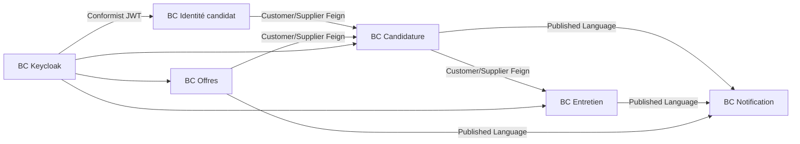
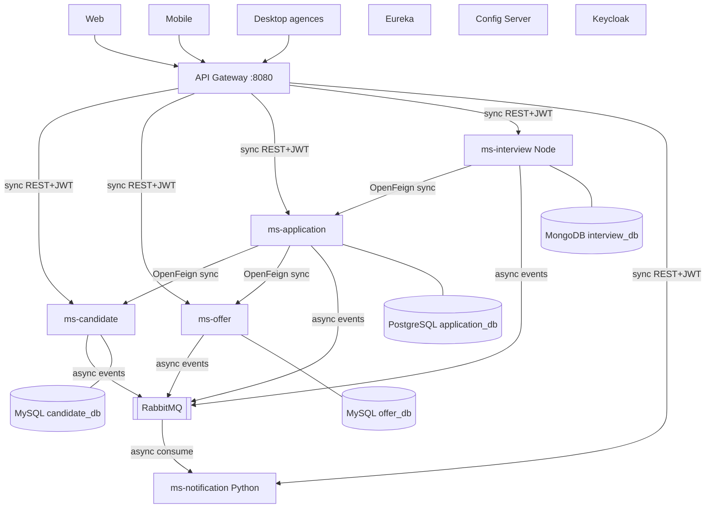

# Prosit n°2 — JobBoard : du backend monolithique aux microservices

**TalentConnect** · ESPRIT · Module AWD · 2026-2027  
**Livrable** : dossier de conception (pas d’implémentation code).  
**Sources vérifiées** : `BackEndRestFul_SpringBoot/awd-monolith` (Spring Boot **3.5.6**, MySQL **`awd_db`**, port **8080**).

---

## 1. Définition des mots-clés

| Terme | Définition (nos mots) liée à JobBoard |
|---|---|
| **Backend monolithique** | Une seule application déployable qui concentre candidat, offres et candidatures dans **un** process JVM. Preuve : artifact Maven `awd-monolith`, classe `AwdMonolithApplication`. |
| **API REST et contrat OpenAPI** | API HTTP ressource/verbe dont le contrat machine est OpenAPI/Swagger. Preuve : springdoc + `OpenApiConfig` (« AWD Recruitment API (monolith) »), UI `/swagger-ui.html`, docs `/v3/api-docs`. |
| **Couplage et cohésion** | **Cohésion** = éléments qui changent pour la même raison (packages `candidat` / `job` / `candidature` assez cohérents). **Couplage** = dépendance entre modules ; ici fort via **une** DB et injections cross-packages (`JobService` → `ApplicationRepository`). |
| **Domain-Driven Design (DDD)** | Conception guidée par le métier : on découpe selon les **capacités** et le langage, pas selon les tables SQL. |
| **Domaine / sous-domaine** | Domaine = recrutement TalentConnect. Sous-domaines typés **cœur** (différenciant), **support** (nécessaire), **générique** (remplaçable). |
| **Langage omniprésent** | Vocabulaire partagé équipe ↔ code (`Job.available`, `Application`, créneau d’entretien, etc.). |
| **Contexte borné (Bounded Context)** | Frontière où un modèle a un sens unique. Ex. « Candidate » complet dans le service candidat ; ailleurs seulement `candidateId`. |
| **Carte de contextes** | Carte des relations entre BC (Customer/Supplier, Published Language, Conformist…). Voir §7. |
| **Déploiement et scalabilité indépendants** | Publier / scaler un service sans republier / scaler les autres. Ex. scaler **seulement** la recherche d’offres (douleur de Sami). |
| **Microservice** | Service autonome déployable autour d’**une capacité métier**, avec sa base et son cycle de vie. |
| **Base de données par service** | Chaque MS a son schéma ; **aucune** FK cross-service (seulement des IDs). Remplace `awd_db` unique. |
| **Monolithe distribué** | « Microservices » trop couplés (1 service/table, DB partagée, sync en chaîne). Explicitement **rejeté** (§10). |
| **Communication synchrone** | L’appelant attend la réponse (REST / OpenFeign). Ex. « le candidat existe-t-il ? » avant de postuler. |
| **Communication asynchrone** | Découplage temporel via broker. Ex. statut candidature → notification **sans** bloquer le POST. |
| **Événement métier** | Fait métier déjà survenu (`ApplicationStatusChanged`, …) publié pour les intéressés. |
| **API Gateway** | Point d’entrée unique pour web, mobile et desktop (routage, JWT, CORS). |
| **ACID** | Propriétés transactionnelles **locales** à une base. Après découpage, plus de transaction unique cross-domaines. |
| **Service Discovery (Eureka)** | Annuaire d’instances ; Gateway/Feign résolvent `lb://ms-offer` sans IP figées. |

---

## 2. Problématique

**Comment concevoir une architecture microservices pour le JobBoard TalentConnect (aujourd’hui monolithe Spring Boot 3.5.6 + MySQL `awd_db` sur le port 8080) qui permette de scaler indépendamment la recherche d’offres, d’isoler les schémas d’équipes, d’intégrer des équipes Node.js (entretiens) et Python (notifications), et de notifier les candidats sans bloquer le dépôt de candidature — sans retomber dans un monolithe distribué (pas un service par table, pas de base partagée, pas de notification synchrone) ?**

---

## 3. Contraintes et attentes des acteurs

| Acteur | Attente | Contrainte / douleur | Décision de design |
|---|---|---|---|
| **Leïla** (produit) | Design **argumenté** : domaines, frontières, ownership, interactions ; construit en équipe | 2 nouvelles équipes : **Node.js** (entretiens), **Python** (notifications) — pas forcées dans le monolithe Java | 5 MS par capacité ; `ms-interview` Node ; `ms-notification` Python ; journal collectif |
| **Karim** (dev) | Ownership clair ; évoluer le schéma Job sans casser Application | 1 DB `awd_db` ; rename colonne `job` → 2 h sans candidatures ; delete lit la table `application` | Database per service ; IDs seulement ; delete via API/event (**plus** de lecture table étrangère) |
| **Karim** (proposition) | — | A proposé **1 service / table** | **Rejetée** avec Sami (§10) |
| **Inès** (mobile) | Notifier au changement de statut ; proposer un créneau d’entretien | E-mail **sync** dans le save ⇒ SMTP down = plus personne ne postule | Event async `ApplicationStatusChanged` → broker → `ms-notification` |
| **Sami** (infra) | Scaler la **recherche d’offres** (×50) sans multiplier le reste | 4 copies du **monolithe entier** ; restart = port **8080** down → 3 clients down | `ms-offer` scalable **seul** ; Gateway + Eureka ; 1 DB / service |

---

## 4. Diagnostic des limites du monolithe (preuves réelles)

### L1 — Un seul process / port 8080 (Sami)

| Preuve | Détail |
|---|---|
| `pom.xml` L7–15 | Parent Spring Boot **3.5.6** ; `artifactId` = `awd-monolith` |
| `AwdMonolithApplication.java` L12–16 | Unique `@SpringBootApplication` |
| `application.properties` L2 | `server.port=8080` |
| Javadoc application L9–10 | « One application, one database, three business modules » |

**Impact** : scaler la recherche = cloner **tout** (candidat + candidature inclus). Un fix redémarre tout ; les 3 clients tombent avec `:8080`.

### L2 — Base partagée `awd_db` + FK cross-domaines (Karim)

| Preuve | Détail |
|---|---|
| `application.properties` L5 | `jdbc:mysql://localhost:3306/awd_db` |
| `database/awd_db.sql` L9–13 | `CREATE DATABASE` / `USE awd_db` |
| `awd_db.sql` L105–110 | `fk_application_candidate`, `fk_application_job` (`ON DELETE RESTRICT`) |
| `awd_db.sql` L29–52, L61–83 | Tables `address`, `candidate`, `category`, `job` |

**Impact** : une équipe Offres qui renomme une colonne de `job` casse le module candidature (schéma + ORM partagés) — scénario Karim (2 h).

### L3 — Lecture de la table `application` avant DELETE (couplage code)

| Preuve | Détail |
|---|---|
| `JobService.java` L22–23, L65–68 | Injecte `ApplicationRepository` ; `existsByJobId` → `ConflictException` |
| `CandidateService.java` L23–25, L71–74 | Idem `existsByCandidateId` |
| `GlobalExceptionHandler` | `ConflictException` → HTTP **409** |
| Test IT | `AwdMonolithApiIntegrationTest.candidateOrJobWithApplicationsCannotBeDeleted` → `isConflict()` |

**Lien Workshop** : dans notre brouillon `Workshop1/reponses-draft.md`, ces comportements sont **E7** (DELETE candidat → 409) et **E8** (DELETE job → 409). Le brief Prosit les cite parfois comme « E9/E10 » : **on s’appuie sur le code et le 409**, pas sur le numéro d’étiquette.

**Impact** : frontières de packages **perméables** ; après MS, cette lecture directe est interdite (§8).

### L4 — Transaction unique cross-modules à la création de candidature

| Preuve | Détail |
|---|---|
| `ApplicationService.java` L33–42 | Injecte `CandidateService` + `JobService` |
| `ApplicationService.create` L69–85 | `@Transactional` : charge candidat + job, vérifie `available`, unicité, `save` |

**Impact** : ACID local aujourd’hui ; impossible à conserver tel quel après distribution → Feign sync pour invariants + events pour effets de bord.

### L5 — Stack 100 % Java vs équipes Node / Python (Leïla)

| Preuve | Détail |
|---|---|
| `pom.xml` | Dépendances Spring Web / JPA / Validation / springdoc — **aucun** runtime Node/Python |

**Impact** : entretiens (Node) et notifications (Python) ne peuvent pas livrer **dans** le monolithe sans forcer Java.

### L6 — Contention d’équipe sur un seul codebase / un seul contrat Swagger

| Preuve | Détail |
|---|---|
| `OpenApiConfig.java` L18–27 | Un seul `OpenAPI` titre « monolith » ; un serveur `localhost:8080` |
| Groupes L34–53 | `0-all`, `1-candidat`, `2-job`, `3-candidature` — **même** process |
| 4 équipes + traffic ×10 (scénario) | Releases et conflits Git sur le même artefact |

**Impact** : une modification Offres impose de retester / redéployer candidature et candidat.

### L7 — Notification synchrone (Inès) — **ASSOMPTION**

| Preuve | Détail |
|---|---|
| Recherche dans `awd-monolith` | **0** `JavaMailSender` / starter-mail / `NotificationService` |
| Scénario Inès | Si SMTP dans `ApplicationService.create` → chaque POST attend le mail ; SMTP down ⇒ plus de candidatures |

**Statut** : **pas dans le code fourni** → exigence de design (notif **async** obligatoire), marquée ASSOMPTION.

---

## 5. Cartographie du domaine

| Sous-domaine | Type | Justification |
|---|---|---|
| **Catalogue / offres d’emploi** | **Cœur** | Différenciant ; charge lecture dominante (Sami ×50) ; cycle `available` |
| **Gestion des candidatures** | **Cœur** | Règles unicité + disponibilité ; cœur du JobBoard |
| **Planification d’entretiens** | **Cœur process RH** (ou support avancé) | Feature trimestre prochain ; modèle distinct ; équipe Node | 
| **Identité / profil candidat** (+ adresse) | **Support** | Nécessaire pour postuler ; Address n’est pas un sous-domaine autonome |
| **Notifications** (e-mail, SMS, push) | **Générique** | Pattern transversal remplaçable ; I/O lente ; Python |
| **IAM (Keycloak)** | **Générique** | Produit standard |

---

## 6. Liste des microservices

**Règle** : découpage par **capacité / BC**, pas par table. 5 services (sweet spot 4–6).

### 6.1 Catalogue

| Service | Techno | DB (justification) | Fait | Ne fait PAS | REST (racines) | Events publiés | Events consommés | Owner |
|---|---|---|---|---|---|---|---|---|
| **ms-candidate** | Java / Spring | MySQL `candidate_db` — relationnel 1–1 Candidate–Address, continuité monolithe | CRUD Candidate + Address | Jobs, candidatures, mails, entretiens | `/api/candidates`, `/api/addresses` | `CandidateDeleted` | — | **Mohamed Aziz Mehrez** |
| **ms-offer** | Java / Spring | MySQL `offer_db` — jobs/catégories relationnels + index `available` ; **scale indépendant** | CRUD Job + Category ; recherche ; availability | Candidats, candidatures, mails | `/api/jobs`, `/api/categories` | `JobAvailabilityChanged` | — | **Mohamed Rayen Sboui** |
| **ms-application** | Java / Spring | PostgreSQL `application_db` — UNIQUE `(candidateId,jobId)` ; indépendance d’équipe | Cycle de vie Application + statuts | Posséder profil/offre ; envoyer mails | `/api/applications` | `ApplicationCreated`, **`ApplicationStatusChanged`** | `JobAvailabilityChanged` (opt.) | **Maryem Slatni** |
| **ms-interview** | **Node.js** | MongoDB `interview_db` — documents souples (slot, meetingUrl, notes) | Créneaux, statut entretien | Recréer Candidate/Job/Application | `/api/interviews` | `InterviewScheduled`, `InterviewCancelled` | — | **Mohamed Ezzedine Zouiten** |
| **ms-notification** | **Python** | Pas de DB métier partagée (logs locaux optionnels) | Consommer events ; e-mail/SMS/push | Décider règles métier candidature | `/api/notifications` (health/ops) | — | `Application*`, `Interview*`, `JobAvailabilityChanged`, `CandidateDeleted` | **Dhia Jbali** |
| **Plateforme** (Gateway, Eureka, Config, Keycloak, Compose) | Spring Cloud / infra | — | Entrée unique, discovery, config, IAM | Règles métier des MS | Gateway `:8080` | — | — | **Samer** |

Infra technique portée par **Samer** : **API Gateway** `:8080`, **Eureka** `:8761`, **Config Server** `:8888`, **Keycloak** `:8180`, **RabbitMQ** `:5672` (broker partagé).

### 6.2 Ownership des 5 tables monolithe

| Table `awd_db` | Owner MS | Pourquoi |
|---|---|---|
| `candidate` | ms-candidate | Identité |
| `address` | ms-candidate | Même BC (pas un MS) |
| `job` | ms-offer | Catalogue / recherche |
| `category` | ms-offer | Classifie les jobs (pas une capacité) |
| `application` | ms-application | Cœur candidature ; stocke `candidateId` + `jobId` (**IDs**, pas FK cross-DB) |

Nom **ms-offer** : capacité « offres » ; package monolithe = `job` (vérifié dans le code).

---

## 7. Carte de contextes (Context Map)

| Upstream | Downstream | Relation | Pourquoi |
|---|---|---|---|
| BC Identité candidat | BC Candidature | **Customer / Supplier** | Validation existence (Feign) |
| BC Offres | BC Candidature | **Customer / Supplier** | Existence + `available` |
| BC Candidature | BC Entretien | **Customer / Supplier** | Interview référence `applicationId` |
| Candidature / Offres / Entretien | BC Notification | **Published Language** | Contrats d’events JSON stables |
| Keycloak | Tous (via Gateway) | **Conformist** | JWT / rôles |
| — | — | **Shared Kernel évité** | Pas de schéma ni lib métier partagés |
| Modèles externes | Notification / clients Feign | **Anti-Corruption Layer** | DTO + mapping events (pas d’entités JPA monolithe) |

Source : `Prosit2/Diagrams/context-map.mmd` · export `context-map.svg`.

---

## 8. Communication

### 8.1 Matrice

| Interaction | Mode | Justification | Si callee / broker down |
|---|---|---|---|
| Clients → Gateway | Sync REST | Entrée unique multi-clients | Erreur client |
| Gateway → MS | Sync (lb Eureka) | Routage | 503 ; instance unhealthy retirée |
| **ms-application → ms-candidate** | **Sync OpenFeign** | Invariant : candidat existe avant postuler | Timeout 2s → retry×3 → CB → **503**, **aucune** écriture Application |
| **ms-application → ms-offer** | **Sync OpenFeign** | Invariant : job `available=true` | Idem fail-fast |
| Choix vs read-model local | Sync Feign retenu | Plus simple pédagogiquement ; cohérence forte à l’écriture ; pas de projection à maintenir en V1 | — |
| ms-interview → ms-application | Sync Feign | Entretien sur candidature réelle | 503 ; pas d’orphelin |
| **Statut candidature → notification** | **Async** event **`ApplicationStatusChanged`** | Exigence Inès : SMTP **ne bloque jamais** le POST | API OK ; messages en queue ; consumer **idempotent** (`eventId`) |
| Création candidature → notif | Async `ApplicationCreated` | Même raison | Idem |
| Interview → notif | Async `InterviewScheduled` / `Cancelled` | Découpler Node ↔ Python | Idem |
| **Delete offre / candidat** (ex-`ApplicationRepository`) | **Sync Feign** vers ms-application : « y a-t-il des candidatures ? » | Remplace lecture table étrangère | Si application down : **bloquer** le delete (fail-safe). Alternative V2 : soft-delete + event de cascade |

### 8.2 Catalogue d’événements

| Event | Producer | Consumers | Payload (JSON) |
|---|---|---|---|
| `CandidateDeleted` | ms-candidate | ms-notification (, ms-application opt.) | `{ eventId, candidateId, occurredAt }` |
| `JobAvailabilityChanged` | ms-offer | ms-application, ms-notification | `{ eventId, jobId, available, occurredAt }` |
| `ApplicationCreated` | ms-application | ms-notification | `{ eventId, applicationId, candidateId, jobId, email?, occurredAt }` |
| **`ApplicationStatusChanged`** | ms-application | **ms-notification** | `{ eventId, applicationId, fromStatus, toStatus, occurredAt }` |
| `InterviewScheduled` | ms-interview | ms-notification | `{ eventId, interviewId, applicationId, slot, meetingUrl?, occurredAt }` |
| `InterviewCancelled` | ms-interview | ms-notification | `{ eventId, interviewId, applicationId, reason?, occurredAt }` |

**Broker** : **RabbitMQ** (juste pour AWD/Compose, UI management, patterns Spring AMQP / pika Python). Kafka = overkill pour le périmètre étudiant.

---

## 9. Architecture cible

Clients (**web**, **mobile candidats**, **desktop agences**) → **API Gateway** → MS (Eureka).  
1 DB / service. Events → **RabbitMQ** → **ms-notification**. Config Server + Keycloak.

**Légende** : flèches Feign/Gateway = **sync** ; flèches RabbitMQ = **async**.  
Fichiers : `Prosit2/Diagrams/architecture.mmd` · `architecture.svg`.

---

## 10. Alternatives rejetées

| Alternative | Pourquoi rejetée |
|---|---|
| **Un service par table** (proposition Karim) | Address/Category ≠ capacités ; 5 MS × appels sync ; panne en cascade = **monolithe distribué**. Objection de Sami retenue. |
| **Garder le monolithe** | Ne résout ni scale search, ni Node/Python, ni ownership de schéma. |
| **Extraire seulement la recherche** | Soulage Sami à court terme ; **ne règle pas** Karim / Leïla / Inès / deletes couplés. |
| **Base partagée type `awd_db`** | Recrée l’incident rename-column ; FK cross-domaine. |
| **Communication 100 % sync** | SMTP dans le chemin critique (Inès) ; monolithe distribué. |

---

## 11. Risques, compromis et feuille de route

### Risques & mitigations

| Risque | Mitigation |
|---|---|
| Latence réseau | Timeout Feign 2s, retry borné, circuit breaker ; sync **seulement** pour invariants |
| Transactions distribuées | Pas de 2PC ; sync pour « peut-on créer ? » ; async + `eventId` pour notifs |
| Cohérence éventuelle | Accepter délai mail ; UI « candidature OK » ≠ « mail déjà parti » |
| Complexité ops | Compose pédagogique ; Actuator health ; Eureka |
| Monolithe distribué | Refus 1 service/table ; journal des frontières ; pas de chaînes sync longues |

### Roadmap (strangler)

| Étape | Action | Pourquoi en premier |
|---|---|---|
| 1 | Extraire **ms-offer** (+ sa DB) derrière Gateway | Charge ×50 (Sami) ; package `job` déjà borné |
| 2 | **ms-candidate** | Package `candidat` autonome ; Address suit |
| 3 | **ms-application** | Remplace les appels in-process par Feign ; casse les FK monolithe |
| 4 | **ms-notification** (Python) + RabbitMQ | Débloque Inès sans toucher au cœur métier |
| 5 | **ms-interview** (Node) | Feature nouvelle ; moins de dette de migration |

---

## Annexe — Vocabulaire canonique (cohérence)

| Concept | Nom unique |
|---|---|
| Services | `ms-candidate`, `ms-offer`, `ms-application`, `ms-interview`, `ms-notification` |
| Bases | `candidate_db`, `offer_db`, `application_db`, `interview_db` |
| Event clé Inès | `ApplicationStatusChanged` |
| Broker | RabbitMQ |
| Gateway / Eureka / Config | `:8080` / `:8761` / `:8888` |
