# JobBoard — Microservices Platform

[](https://openjdk.org/)
[](https://spring.io/projects/spring-boot)
[](https://spring.io/projects/spring-cloud)
[](https://www.python.org/)
[](https://fastapi.tiangolo.com/)
[](https://docs.docker.com/compose/)
[](#project-status)
[](https://github.com/AzizMehrez/JobBoard-AWD-4SSA8)

> **ESPRIT · AWD 2026–2027 · Validation 1**  
> A recruitment platform redesigned as a **polyglot microservices architecture** (Spring Cloud + Python), derived from pedagogical Symfony and Spring Boot monoliths.

**Public repository:** [github.com/AzizMehrez/JobBoard-AWD-4SSA8](https://github.com/AzizMehrez/JobBoard-AWD-4SSA8)

---

## Table of Contents

1. [Project Overview](#project-overview)
2. [Project Status](#project-status)
3. [Key Features](#key-features)
4. [Technology Stack](#technology-stack)
5. [System Architecture](#system-architecture)
6. [Diagrams](#diagrams)
7. [Project Structure](#project-structure)
8. [Prerequisites](#prerequisites)
9. [Installation and Setup](#installation-and-setup)
10. [Environment Configuration](#environment-configuration)
11. [Running the Application](#running-the-application)
12. [Service Ports](#service-ports)
13. [API Documentation](#api-documentation)
14. [Database Design](#database-design)
15. [Security](#security)
16. [Testing and Verification](#testing-and-verification)
17. [Reference Applications](#reference-applications)
18. [Documentation Index](#documentation-index)
19. [Development Workflow](#development-workflow)
20. [Roadmap](#roadmap)
21. [Team](#team)
22. [License](#license)

---

## Project Overview

**JobBoard** is a job-recruitment platform for candidates, recruiters, and administrators. Organizations publish categorized job offers; candidates apply, track applications, and receive notifications; recruiters review candidatures and schedule interviews.

### Problem

Two teaching monoliths — a **Symfony 6.4 Twig** app and a **Spring Boot REST** app sharing a single MySQL database — couple all domains into one deployable unit. That design blocks independent scaling, polyglot persistence, and clean consumption by a future SPA or mobile client.

### Solution

The domain is split into **five bounded contexts**, each owning its data store, plus a Spring Cloud edge and platform layer:

| Bounded context | Service | Persistence |
|---|---|---|
| Candidate profile | `ms-candidate` | MySQL |
| Jobs & categories | `ms-job` | MySQL |
| Applications | `ms-application` | PostgreSQL |
| Interviews | `ms-interview` | MongoDB |
| Notifications (advanced) | `ms-notification` | Event-driven (RabbitMQ) |

### Target users

| Actor | Goals |
|---|---|
| **Candidate** | Manage profile, browse open jobs, apply once per offer, track status, receive emails |
| **Recruiter** | Publish / close offers, review applications, schedule interviews |
| **Administrator** | Manage categories, protect APIs with IAM, monitor health |
| **Notification system** | React to domain events asynchronously |

### Objectives (Validation 1)

- Domain-driven analysis and microservices decomposition with rejected alternatives documented  
- Compilable / startable service skeletons + full platform (Eureka, Config Server, API Gateway, Compose)  
- Database-per-service, sync (OpenFeign) and async (RabbitMQ) interaction design  
- Oral defence pack (12-slide deck, Q&A prep, self-audit)

---

## Project Status

| Area | State |
|---|---|
| Conception (E1–E6, I1–I4) | Complete — see [`Documentation/`](Documentation/) |
| Platform (Eureka, Config, Gateway, Compose) | Operational |
| `ms-job` | **Business CRUD implemented** (jobs + categories) |
| `ms-candidate`, `ms-application`, `ms-interview` | Validation 1 skeletons (ping endpoints + layered packages) |
| `ms-notification` | FastAPI health + ping; RabbitMQ consumer **not wired yet** |
| Keycloak | Container in Compose; **JWT enforcement on Gateway not wired yet** |
| Frontend | Placeholder only — **not required for Validation 1** |

Validation 1 deliberately prioritises **architecture and runnable skeletons** over full business logic. Remaining CRUD and security work is tracked in [`TASKS.md`](TASKS.md).

---

## Key Features

### Platform capabilities (implemented)

- **API Gateway** (`:8080`) — path-based routing to business services via Eureka load balancing  
- **Service discovery** — Netflix Eureka (`:8761`)  
- **Centralized configuration** — Spring Cloud Config (native filesystem `config-repo`)  
- **Database-per-service** — MySQL × 2, PostgreSQL, MongoDB  
- **Messaging infrastructure** — RabbitMQ with management UI  
- **IAM container** — Keycloak (`:8180`, `start-dev`) ready for later JWT integration  
- **Health endpoints** — Spring Actuator + FastAPI `/actuator/health`  
- **Local DX** — `start-all` scripts and H2 / `nodb` profiles without Docker databases  

### Job domain API (implemented in `ms-job`)

- Full **CRUD** for jobs and categories  
- Filter jobs by `available` and `categoryId`  
- Patch job availability without full update  
- Category uniqueness and delete-protection when jobs exist  
- Validation + RFC 7807-style exception handling  

### Designed for next iterations (documented, not fully coded)

- Candidate / address management  
- Apply-once workflow with Feign calls to candidate & job services  
- Interview scheduling against applications  
- Async email notifications on application / interview events  
- Keycloak JWT roles on the Gateway  

---

## Technology Stack

### Backend — Java microservices

| Technology | Version / note |
|---|---|
| Java | **17** |
| Spring Boot | **3.3.5** |
| Spring Cloud | **2023.0.3** |
| Spring Cloud Gateway | Edge routing |
| Netflix Eureka | Service discovery |
| Spring Cloud Config | Native file backend |
| Spring Data JPA | `ms-candidate`, `ms-job`, `ms-application` |
| Spring Data MongoDB | `ms-interview` |
| OpenFeign + Resilience4j | Prepared for sync calls (V2) |
| Spring AMQP | Dependency present; listeners disabled in V1 |
| Maven | Multi-module parent `jobboard-parent` |

### Backend — Python (advanced service)

| Technology | Version |
|---|---|
| FastAPI | 0.115.0 |
| Uvicorn | 0.30.6 |
| Pika | 1.3.2 |
| Pydantic / HTTPX | 2.9.2 / 0.27.2 |

### Data & messaging

| Store | Used by | Host port |
|---|---|---|
| MySQL 8.0 | `ms-candidate` | 3307 |
| MySQL 8.0 | `ms-job` | 3308 |
| PostgreSQL 16 | `ms-application` | 5433 |
| MongoDB 7 | `ms-interview` | 27017 |
| RabbitMQ 3.13 (management) | events / notification | 5672 / 15672 |
| H2 (profile `h2`) | local runs without Docker DBs | in-memory |

### Infrastructure & DevOps

- Docker / Docker Compose (`Backend/docker-compose.yml`)  
- Keycloak 25.0.0 (`start-dev`)  
- Shell / Batch helpers: `start-all.sh`, `start-all.bat`, `scripts/verify.*`  

### Reference monoliths (teaching baselines)

| App | Stack |
|---|---|
| `JobBoard_Symfony_6_4/` | PHP 8.1+, Symfony 6.4, Doctrine, Twig, Security form-login |
| `BackEndRestFul_SpringBoot/awd-monolith/` | Spring Boot 3.5.6, JPA, MySQL, springdoc OpenAPI |

### Frontend

Placeholder README only — SPA (Angular/React) or mobile planned against Gateway `:8080`.

---

## System Architecture

Clients call the **API Gateway**. Java business services register with **Eureka** and pull optional config from the **Config Server**. Each service owns its database. Synchronous cross-service calls are designed via **OpenFeign**; asynchronous side effects go through **RabbitMQ** to `ms-notification`.

<p align="center">
  
</p>

<p align="center"><em>Figure 1 — Global architecture (source: <a href="Documentation/Diagrams/architecture.mmd">architecture.mmd</a>)</em></p>

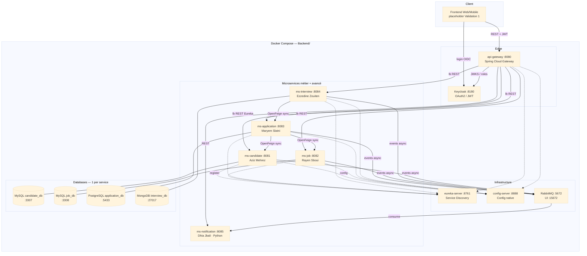

**Architectural decisions (documented in detail under `Documentation/`):**

1. **One database per service** — no shared schema, no cross-DB foreign keys  
2. **Logical references** between contexts (`candidateId`, `jobId`, `applicationId`)  
3. **Sync vs async** — Feign for request-time validation; RabbitMQ for notifications  
4. **Polyglot persistence** — relational for structured BCs, MongoDB for interview documents, Python for the advanced notification service  
5. **Shared Kernel avoided** — bounded contexts communicate via APIs and events  

> **Note:** Keycloak JWT, Feign business calls, and RabbitMQ consumers are **designed and diagrammed**; only platform wiring + `ms-job` CRUD are fully coded in Validation 1. See [Project Status](#project-status).

---

## Diagrams

Official design diagrams live in [`Documentation/Diagrams/`](Documentation/Diagrams/) (Mermaid sources `.mmd` + SVG exports). They are embedded below for GitHub rendering.

| Diagram | SVG | Mermaid source |
|---|---|---|
| Global architecture | [`architecture.svg`](Documentation/Diagrams/architecture.svg) | [`architecture.mmd`](Documentation/Diagrams/architecture.mmd) |
| DDD context map | [`context-map.svg`](Documentation/Diagrams/context-map.svg) | [`context-map.mmd`](Documentation/Diagrams/context-map.mmd) |
| Use cases | [`use-cases.svg`](Documentation/Diagrams/use-cases.svg) | [`use-cases.mmd`](Documentation/Diagrams/use-cases.mmd) |
| Events flow | [`events-flow.svg`](Documentation/Diagrams/events-flow.svg) | [`events-flow.mmd`](Documentation/Diagrams/events-flow.mmd) |
| Apply sequence | [`sequence-apply.svg`](Documentation/Diagrams/sequence-apply.svg) | [`sequence-apply.mmd`](Documentation/Diagrams/sequence-apply.mmd) |
| ER candidate | [`er-candidate.svg`](Documentation/Diagrams/er-candidate.svg) | [`er-candidate.mmd`](Documentation/Diagrams/er-candidate.mmd) |
| ER job | [`er-job.svg`](Documentation/Diagrams/er-job.svg) | [`er-job.mmd`](Documentation/Diagrams/er-job.mmd) |
| ER application | [`er-application.svg`](Documentation/Diagrams/er-application.svg) | [`er-application.mmd`](Documentation/Diagrams/er-application.mmd) |
| ER interview | [`er-interview.svg`](Documentation/Diagrams/er-interview.svg) | [`er-interview.mmd`](Documentation/Diagrams/er-interview.mmd) |

### DDD context map

<p align="center">
  
</p>

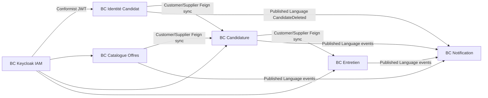

### Use cases

<p align="center">
  
</p>

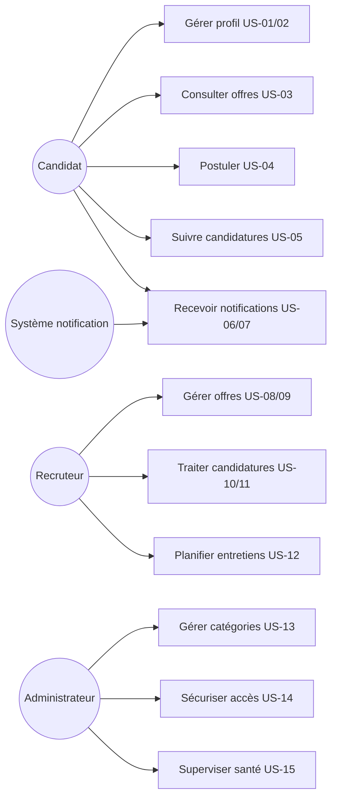

### Domain events (RabbitMQ)

<p align="center">
  
</p>

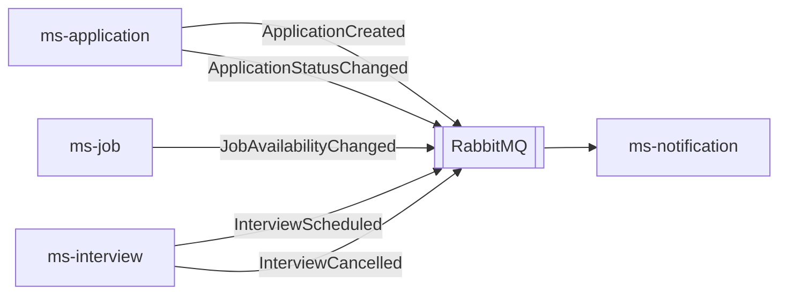

### Apply sequence

<p align="center">
  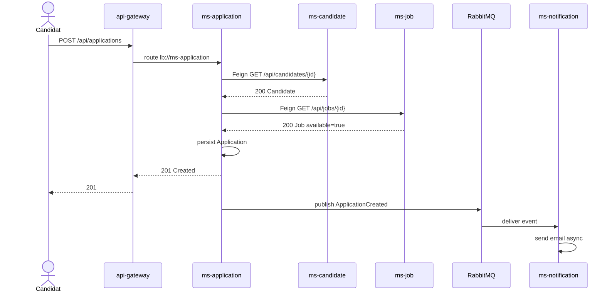
</p>

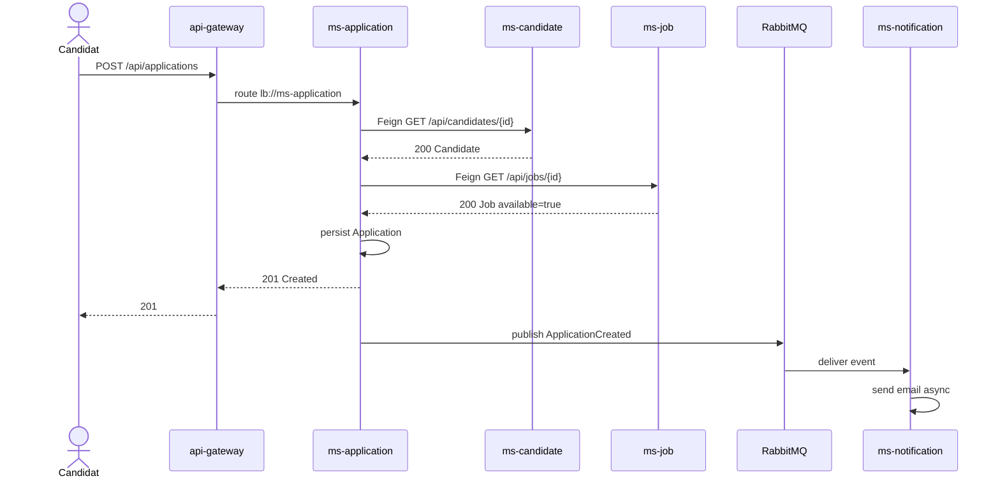

---

## Project Structure

```text
.
├── Backend/                          # Microservices monorepo (main deliverable)
│   ├── pom.xml                       # Parent BOM — Boot 3.3.5 / Cloud 2023.0.3
│   ├── docker-compose.yml            # DBs + RabbitMQ + Keycloak + all services
│   ├── config-repo/                  # Native Config Server files
│   ├── eureka-server/                # Discovery :8761
│   ├── config-server/                # Config :8888
│   ├── api-gateway/                  # Edge :8080
│   ├── ms-candidate/                 # Candidate BC :8081 (skeleton)
│   ├── ms-job/                       # Job BC :8082 (CRUD implemented)
│   ├── ms-application/               # Application BC :8083 (skeleton)
│   ├── ms-interview/                 # Interview BC :8084 (skeleton)
│   ├── ms-notification/              # FastAPI :8085 (skeleton)
│   ├── start-all.bat / start-all.sh  # Local multi-process launcher
│   └── README.md
├── Frontend/                         # Placeholder (no UI yet)
├── Documentation/                    # Validation 1 design dossier (FR)
│   ├── 00–05-*.md                    # Subject, DDD, split, APIs, events, architecture
│   ├── Diagrams/                     # .mmd sources + .svg exports
│   ├── Presentation/                 # PPTX + speaker notes
│   ├── Prosit1/ Prosit2/ Workshop1/
│   └── SELF_AUDIT.md · QA_PREP.md · …
├── JobBoard_Symfony_6_4/             # Reference Twig monolith
├── BackEndRestFul_SpringBoot/        # Reference Spring REST monolith
├── Prosit2/                          # Prosit n°2 design pack
├── scripts/                          # verify.*, presentation builders, scaffold
├── README.md                         # This file
├── TASKS.md                          # Backlog & ownership
└── TODO.md                           # Validation 1 checklist
```

---

## Prerequisites

| Tool | Version / notes |
|---|---|
| **JDK** | **17** |
| **Maven** | **3.9+** |
| **Docker Desktop** + Compose | Recommended for full stack |
| **Python** | **3.12+** (for `ms-notification` and optional PPTX scripts) |
| **pip** | To install `Backend/ms-notification/requirements.txt` |
| **Git** | Clone / contribute |
| **curl** or a browser | Health checks |

Optional for reference apps: PHP 8.1+ / Composer (Symfony), MySQL for the Spring monolith.

---

## Installation and Setup

### 1. Clone the repository

```bash
git clone https://github.com/AzizMehrez/JobBoard-AWD-4SSA8.git
cd JobBoard-AWD-4SSA8
```

### 2. Build all Java modules

```bash
cd Backend
mvn -DskipTests package
```

### 3. Choose a run mode

| Mode | When to use |
|---|---|
| **A — Docker Compose** | Full demo: DBs, RabbitMQ, Keycloak, all services |
| **B — Local + H2 / nodb** | Fast development without Docker databases |
| **C — `start-all` scripts** | One-shot local launch (Windows / Linux / macOS) |

---

## Environment Configuration

There is **no** root `.env.example`. Configuration comes from:

1. Each service’s `src/main/resources/application.yml`  
2. Optional Config Server (`Backend/config-repo/`)  
3. Docker Compose `environment:` overrides  

### Compose credentials (local demos only)

These values are **hard-coded demo placeholders** in `Backend/docker-compose.yml`. Do **not** reuse them outside a local lab.

| Component | Variable / access | Demo value |
|---|---|---|
| MySQL (candidate / job) | `MYSQL_ROOT_PASSWORD` | `root` |
| PostgreSQL (application) | user / password | `app` / `app` |
| RabbitMQ | user / password | `guest` / `guest` |
| Keycloak admin | `KEYCLOAK_ADMIN` / `_PASSWORD` | `admin` / `admin` |
| Notification | `RABBITMQ_HOST` | `rabbitmq` (Compose) |
| Gateway → notification | `NOTIFICATION_URI` | `http://ms-notification:8085` |

### Useful Spring overrides (local)

| Variable | Purpose | Example |
|---|---|---|
| `EUREKA_CLIENT_SERVICEURL_DEFAULTZONE` | Eureka registry URL | `http://localhost:8761/eureka/` |
| `SPRING_CONFIG_IMPORT` | Config Server | `optional:configserver:http://localhost:8888` |
| `SPRING_DATASOURCE_URL` | JDBC URL per service | see Compose |
| `SPRING_DATA_MONGODB_URI` | Mongo URI | `mongodb://localhost:27017/interview_db` |
| `SPRING_RABBITMQ_HOST` | Broker host | `localhost` or `rabbitmq` |
| `NOTIFICATION_URI` | Gateway → Python service | `http://localhost:8085` |

Never commit real secrets. `.env` and secret-bearing Keycloak exports are ignored via [`.gitignore`](.gitignore).

---

## Running the Application

### Option A — Docker Compose (recommended for full stack)

```bash
cd Backend
mvn -DskipTests package
docker compose up --build
```

Then open:

| UI / endpoint | URL |
|---|---|
| Eureka dashboard | http://localhost:8761 |
| API Gateway | http://localhost:8080 |
| Keycloak | http://localhost:8180 |
| RabbitMQ management | http://localhost:15672 |

Stop with `docker compose down` (add `-v` only if you intentionally want to wipe DB volumes).

### Option B — Local without Docker databases

Start infrastructure, then business services with in-memory / no-DB profiles:

```bash
cd Backend
mvn -DskipTests package

# Terminal 1–3 — platform
mvn -pl eureka-server spring-boot:run
mvn -pl config-server spring-boot:run
mvn -pl api-gateway spring-boot:run

# Business services
mvn -pl ms-candidate spring-boot:run -Dspring-boot.run.profiles=h2
mvn -pl ms-job spring-boot:run -Dspring-boot.run.profiles=h2
mvn -pl ms-application spring-boot:run -Dspring-boot.run.profiles=h2
mvn -pl ms-interview spring-boot:run -Dspring-boot.run.profiles=nodb

# Notification (separate shell)
cd ms-notification
pip install -r requirements.txt
python -m uvicorn app.main:app --port 8085
```

### Option C — Helper scripts

```bash
cd Backend

# Windows
.\start-all.bat

# Linux / macOS
chmod +x start-all.sh && ./start-all.sh
```

Scripts package with Maven, start Eureka → Config → Gateway, launch Java services with `h2` / `nodb`, and start Uvicorn on `:8085`. They do **not** start Docker databases, RabbitMQ, or Keycloak.

### Quick health checks

```bash
curl http://localhost:8761/actuator/health
curl http://localhost:8080/actuator/health
curl http://localhost:8081/actuator/health
curl http://localhost:8082/actuator/health
curl http://localhost:8083/actuator/health
curl http://localhost:8084/actuator/health
curl http://localhost:8085/actuator/health
```

---

## Service Ports

| Component | Port | Notes |
|---|---|---|
| api-gateway | 8080 | Public API entry |
| ms-candidate | 8081 | MySQL `candidate_db` |
| ms-job | 8082 | MySQL `job_db` |
| ms-application | 8083 | PostgreSQL `application_db` |
| ms-interview | 8084 | MongoDB `interview_db` |
| ms-notification | 8085 | FastAPI |
| eureka-server | 8761 | Discovery UI |
| config-server | 8888 | Native config |
| Keycloak | 8180 | IAM (dev mode) |
| RabbitMQ AMQP / UI | 5672 / 15672 | Messaging |
| MySQL candidate | 3307 → 3306 | Compose |
| MySQL job | 3308 → 3306 | Compose |
| PostgreSQL application | 5433 → 5432 | Compose |
| MongoDB interview | 27017 | Compose |

---

## API Documentation

All paths below are reachable **directly** on the service port, or via the Gateway when the target service is registered in Eureka.

### Gateway routing

| Predicate | Target |
|---|---|
| `/api/candidates/**`, `/api/addresses/**` | `lb://ms-candidate` |
| `/api/jobs/**`, `/api/categories/**` | `lb://ms-job` |
| `/api/applications/**` | `lb://ms-application` |
| `/api/interviews/**` | `lb://ms-interview` |
| `/api/notifications/**` | `ms-notification` (`NOTIFICATION_URI`) |
| `/ms-notification/**` | `ms-notification` (StripPrefix=1) |

> Gateway routes for candidates / applications / interviews are **pre-wired**. Matching business controllers are **not** implemented yet (except job/category APIs).

### `ms-job` — implemented REST API

Base: `http://localhost:8082` or via Gateway `http://localhost:8080`

#### Jobs — `/api/jobs`

| Method | Path | Purpose |
|---|---|---|
| `GET` | `/api/jobs` | List / filter (`available`, `categoryId` query params) |
| `GET` | `/api/jobs/{id}` | Get one job |
| `POST` | `/api/jobs` | Create job (`201` + `Location`) |
| `PUT` | `/api/jobs/{id}` | Update job |
| `PATCH` | `/api/jobs/{id}/availability?available=` | Toggle availability |
| `DELETE` | `/api/jobs/{id}` | Delete job (`204`) |

**Create body example:**

```http
POST /api/jobs
Content-Type: application/json

{
  "name": "Backend Engineer",
  "description": "Spring Cloud microservices",
  "available": true,
  "date": "2026-11-16",
  "categoryId": 1
}
```

#### Categories — `/api/categories`

| Method | Path | Purpose |
|---|---|---|
| `GET` | `/api/categories` | List categories |
| `GET` | `/api/categories/{id}` | Get category |
| `GET` | `/api/categories/{id}/jobs` | Jobs in category |
| `POST` | `/api/categories` | Create (unique name) |
| `PUT` | `/api/categories/{id}` | Update |
| `DELETE` | `/api/categories/{id}` | Delete if no jobs; else conflict |

Authentication: **none** on these endpoints today (open local APIs).

### Skeleton / ping endpoints

| Service | Method | Path | Response gist |
|---|---|---|---|
| ms-candidate | `GET` | `/api/placeholder/ping` | `{ status: ok, service: candidate }` |
| ms-application | `GET` | `/api/placeholder/ping` | `{ status: ok, service: application }` |
| ms-interview | `GET` | `/api/placeholder/ping` | `{ status: ok, service: interview }` |
| ms-notification | `GET` | `/api/notifications/ping` | `{ status: ok, service: notification }` |
| ms-notification | `GET` | `/actuator/health` | `{ status: UP, service: ms-notification }` |

Planned APIs for other services are specified in [`Documentation/03-fiches-microservices.md`](Documentation/03-fiches-microservices.md).

---

## Database Design

### Isolation principle

Each microservice owns its database. Cross-context links are **logical IDs**, not foreign keys across databases.

### Implemented (`ms-job` / MySQL `job_db`)

| Entity | Fields | Rules |
|---|---|---|
| `Category` | `id`, `name` (unique), `description` | Cannot delete while jobs reference it |
| `Job` | `id`, `name`, `description`, `available`, `date`, `category` | Many jobs → one category |

<p align="center">
  
</p>

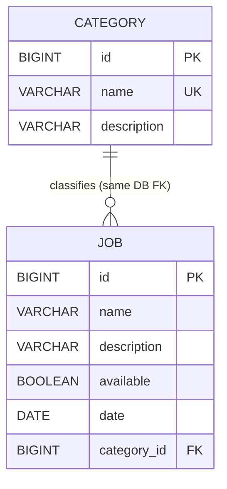

### Designed — Candidate (`ms-candidate` / MySQL)

<p align="center">
  
</p>

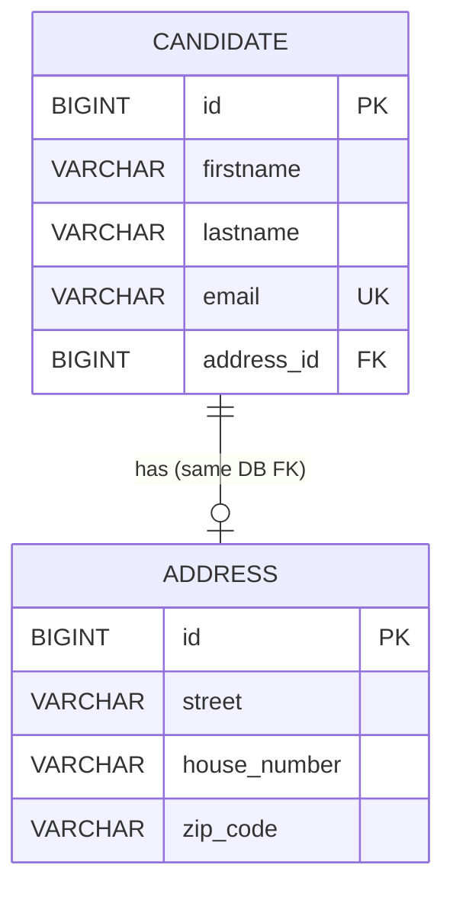

### Designed — Application (`ms-application` / PostgreSQL)

Logical references only — **no** cross-database foreign keys.

<p align="center">
  
</p>

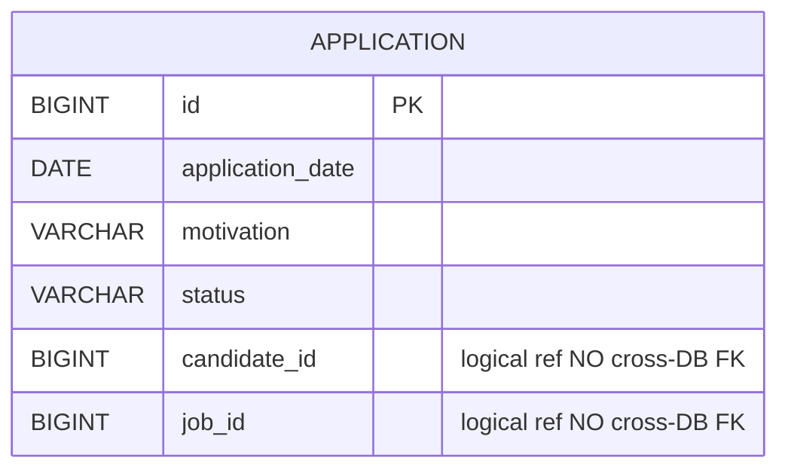

### Designed — Interview (`ms-interview` / MongoDB)

<p align="center">
  
</p>

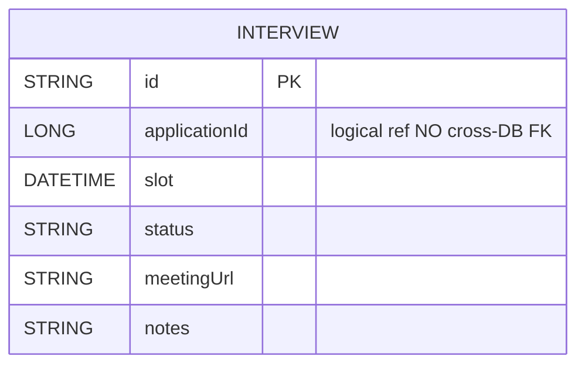

| Context | Store | Main concepts | Maturity |
|---|---|---|---|
| Job / Category | MySQL | Same-DB FK `category_id` | **Implemented** |
| Candidate / Address | MySQL | Same-DB FK planned | Designed / skeleton |
| Application | PostgreSQL | Logical `candidate_id` / `job_id` | Designed / skeleton |
| Interview | MongoDB | Logical `applicationId` | Designed / skeleton |

---

## Security

| Mechanism | Current state |
|---|---|
| Keycloak container | Present in Compose (`:8180`, admin demo credentials) |
| OAuth2 / JWT on Gateway | **Not implemented** — planned backlog item B6 |
| Service-to-service auth | Not implemented |
| Spring Security on MS | Not present on Java business services |
| Secrets in Git | Demo Compose passwords only; real secrets gitignored |

Treat Compose credentials as **local lab defaults**. Rotate and externalise secrets before any shared or production deployment.

The Symfony reference app uses classic **form login + session roles** (`ROLE_CANDIDATE`, `ROLE_COMPANY`, `ROLE_ADMIN`) — useful as a behavioural baseline, not as the target MS security model.

---

## Testing and Verification

### Automated unit / integration tests (microservices)

The Validation 1 Java / Python microservices **do not yet ship a dedicated test suite** (`src/test` / pytest). Prefer the stack verification scripts and Actuator health checks.

### Stack verification scripts

From the repository root:

```bash
# Windows
scripts\verify.bat

# Linux / macOS
chmod +x scripts/verify.sh && ./scripts/verify.sh
```

These scripts:

1. Build each Maven module  
2. Run `docker compose up -d --build`  
3. Wait for Actuator / Keycloak readiness  
4. Check Eureka registration and health  
5. Assert DB isolation expectations  

### Reference monolith tests

| Project | How |
|---|---|
| Symfony | `cd JobBoard_Symfony_6_4 && php bin/phpunit` (PHPUnit config present) |
| Spring monolith | H2 configured for tests under `awd-monolith` |

---

## Reference Applications

These folders are **pedagogical baselines**, not the Validation 1 runtime target.

### Symfony JobBoard (`JobBoard_Symfony_6_4/`)

- Public job browse / search  
- Candidate profile, skills, apply-once, cover letter  
- Company job publishing and application counts  
- Admin dashboard  
- Auth: Symfony Security form login  

### Spring REST monolith (`BackEndRestFul_SpringBoot/awd-monolith/`)

- REST CRUD for candidates/addresses, jobs/categories, applications  
- Shared MySQL `awd_db`  
- springdoc OpenAPI / Swagger grouping  
- No Spring Security  

Package boundaries in the monolith map directly to the future microservices.

---

## Documentation Index

| Document | Path |
|---|---|
| Subject, actors, 15 user stories (E1) | [`Documentation/00-sujet-et-perimetre.md`](Documentation/00-sujet-et-perimetre.md) |
| DDD analysis | [`Documentation/01-analyse-domaine-ddd.md`](Documentation/01-analyse-domaine-ddd.md) |
| Microservice split + rejected alternatives (E2) | [`Documentation/02-decoupage-microservices.md`](Documentation/02-decoupage-microservices.md) |
| Per-service design sheets (I1/I2) | [`Documentation/03-fiches-microservices.md`](Documentation/03-fiches-microservices.md) |
| Data & events matrix (E3) | [`Documentation/04-matrice-interactions.md`](Documentation/04-matrice-interactions.md) |
| Architecture (E4) | [`Documentation/05-architecture.md`](Documentation/05-architecture.md) |
| GitHub / process (E5) | [`Documentation/PROJECT_MANAGEMENT.md`](Documentation/PROJECT_MANAGEMENT.md) |
| Oral Q&A prep (I4) | [`Documentation/QA_PREP.md`](Documentation/QA_PREP.md) |
| Self-audit grid | [`Documentation/SELF_AUDIT.md`](Documentation/SELF_AUDIT.md) |
| E1–E6 status | [`Documentation/VALIDATION1_E1_E6.md`](Documentation/VALIDATION1_E1_E6.md) |
| Member briefs | [`Documentation/MEMBER_BRIEFS.md`](Documentation/MEMBER_BRIEFS.md) |
| Diagrams (Mermaid + SVG) | [`Documentation/Diagrams/`](Documentation/Diagrams/) — also embedded in [Diagrams](#diagrams) |
| Presentation (12 slides) | [`Documentation/Presentation/Validation1-JobBoard.pptx`](Documentation/Presentation/Validation1-JobBoard.pptx) |
| Docs index | [`Documentation/README.md`](Documentation/README.md) |

> Application UI screenshots are not stored in this repository yet; architecture and design diagrams are embedded above.

---

## Development Workflow

### Branching

| Branch | Use |
|---|---|
| `main` | Stable deliverable |
| `feature/<service>-<short-desc>` | Service feature work |
| `docs/<topic>` | Documentation-only changes |

### Commits

Use [Conventional Commits](https://www.conventionalcommits.org/) in **English**, for example:

```text
feat(job): add category delete guard when jobs exist
docs: clarify Validation 1 maturity in README
chore(compose): align notification healthcheck
```

### Ownership

| Member | Ownership |
|---|---|
| Mohamed Aziz Mehrez | `ms-candidate` |
| Mohamed Rayen Sboui | `ms-job` |
| Maryem Slatni | `ms-application` |
| Mohamed Ezzedine Zouiten | `ms-interview` |
| Dhia Jbali | `ms-notification` |
| Samer | Gateway, Eureka, Config Server, Keycloak, Compose |

One issue → one short PR. Track progress in [`TASKS.md`](TASKS.md) and [`TODO.md`](TODO.md). Process details: [`Documentation/PROJECT_MANAGEMENT.md`](Documentation/PROJECT_MANAGEMENT.md).

### Contributor checklist

1. Fork / clone and create a feature branch  
2. Implement only within your bounded context when possible  
3. Keep ports, service names, and event names aligned with the docs  
4. Run `mvn -DskipTests package` (and verification scripts when touching infra)  
5. Open a PR with a clear summary and test notes  

---

## Roadmap

From [`TASKS.md`](TASKS.md) — post–Validation 1 business backlog:

| ID | Item | Service |
|---|---|---|
| B1 | Real Candidate / Address CRUD | `ms-candidate` |
| B2 | Job / Category CRUD | `ms-job` — **done in code** |
| B3 | Apply flow + Feign + domain events | `ms-application` |
| B4 | Schedule / cancel interview | `ms-interview` |
| B5 | RabbitMQ consumer + email | `ms-notification` |
| B6 | Keycloak JWT enforcement on Gateway | `api-gateway` |

Also planned: SPA frontend consuming Gateway + Keycloak; GitHub Projects board for issue tracking.

---

## Team

| Member | Role |
|---|---|
| **Mohamed Aziz Mehrez** | `ms-candidate` |
| **Mohamed Rayen Sboui** | `ms-job` |
| **Maryem Slatni** | `ms-application` |
| **Mohamed Ezzedine Zouiten** | `ms-interview` |
| **Dhia Jbali** | `ms-notification` (Python / advanced) |
| **Samer** | Platform — API Gateway, Eureka, Config Server, Keycloak, Compose |

**Module:** ESPRIT AWD 2026–2027 · Validation 1  

---

## License

No project-level license file is published in this repository at this time.  
The Symfony reference module declares `"license": "MIT"` in its own `composer.json`; that applies to that subtree’s Composer metadata, not to the microservices deliverable as a whole.

---

<div align="center">

**JobBoard AWD** · Microservices · Spring Cloud · FastAPI · Database-per-service  

[Documentation](Documentation/) · [Backend](Backend/) · [Tasks](TASKS.md) · [GitHub](https://github.com/AzizMehrez/JobBoard-AWD-4SSA8)

</div>
